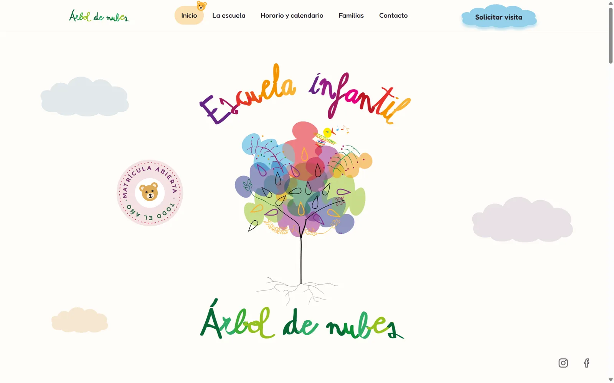
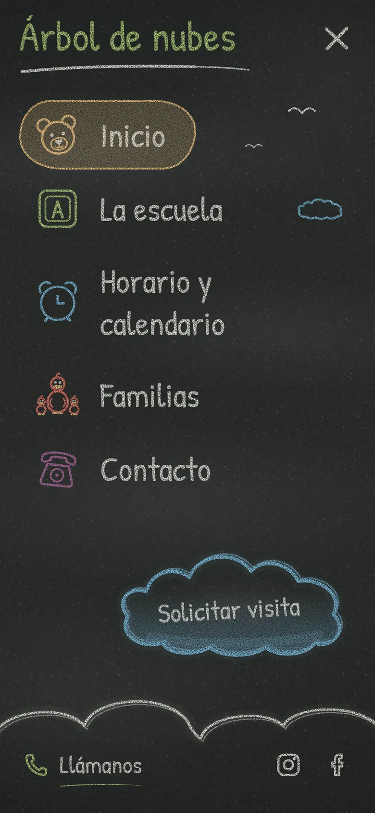

# Escuela Infantil Árbol de Nubes

Web de una escuela infantil real de 0 a 3 años en Carranque (Toledo). Es un encargo para sus tres directoras: lo que se ve es lo que usan las familias para conocer la escuela y pedir una visita.

- **Web:** TODO (dirección definitiva cuando se publique)
- **Cliente:** real, en producción.
- **Mi papel:** requisitos con las clientas, diseño y dirección del desarrollo con IA (Claude Code), pruebas en dispositivos reales.
- **Stack:** React 19 · TypeScript · Vite · Tailwind CSS v4 · Playwright + axe · Netlify.
- **Lo más destacable:** accesibilidad, rendimiento en iPhone e interacciones propias (menú que se escribe a tiza, pizarra en la que se dibuja).

<p>
  
  
</p>

## Lighthouse

Medido con [PageSpeed Insights](https://pagespeed.web.dev/) sobre la web publicada.

| | Rendimiento | Accesibilidad | Buenas prácticas | SEO |
| --- | --- | --- | --- | --- |
| Móvil | TODO | TODO | TODO | TODO |
| Escritorio | TODO | TODO | TODO | TODO |

## Mi papel: desarrollo dirigido con IA

El código lo ha escrito **Claude Code** (IA de Anthropic) siguiendo mis instrucciones. No es una plantilla generada de una vez: se construyó por iteraciones, y en cada una yo decidía qué se hacía, cómo tenía que quedar y cuándo estaba bien.

Mi parte del trabajo:

- **Requisitos con las clientas.** Hablar con las directoras, recoger los datos, los textos, las fotos y los permisos, y traducir lo que necesitaban a funcionalidades concretas.
- **Ideas y dirección de diseño.** La identidad de la web es mía: el menú del móvil como una pizarra que se escribe a tiza, el árbol del logo que tiembla al hacer scroll y suelta pájaros, el formulario como una carta en una hoja de cuaderno con un camión de bomberos para enviar, la pizarra en la que se puede dibujar con tizas de colores y borrar, la página 404 con un osito volando sobre una nube…
- **Especificación y reglas.** Un archivo de especificación vivo ([CLAUDE.md](CLAUDE.md)) con las reglas del proyecto: todos los datos en un único sitio, TypeScript estricto, accesibilidad, movimiento reducido, qué se descarta y por qué. Más el sistema visual en [DESIGN.md](DESIGN.md).
- **Revisión y pruebas en dispositivos reales.** Revisar cada cambio en el navegador y en mi iPhone, pedir correcciones y decidir entre alternativas. Por ejemplo, detecté que el menú tardaba en abrirse en el iPhone y que el inicio temblaba al volver arriba; se midió la causa y elegí la solución probando las variantes en el propio móvil.
- **Entender lo que se entrega.** Cada cambio venía explicado (qué archivo, qué línea y por qué), y tengo una guía del proyecto para mantenerlo.

Si quieres ver código escrito por mí a mano: TODO (enlace al repositorio del gimnasio).

## Qué tiene la web

- **5 páginas principales** (Inicio, La escuela, Horario y calendario, Familias y Contacto), 2 legales (aviso legal y privacidad) y una 404 propia.
- **Menú de móvil en forma de pizarra:** se escribe a tiza de arriba abajo la primera vez que se abre en la visita, con dibujos a tiza de cada página.
- **Pizarra interactiva** al final de las páginas y en la 404: se dibuja con el ratón o el dedo, se cogen tizas de colores y se borra con el borrador (`<canvas>`, eventos de puntero, trazo con textura de tiza).
- **Formulario de solicitud de visita** con Netlify Forms: validación en tiempo real, consentimiento obligatorio y protección contra spam.
- **Calendario escolar** que se amplía en un visor y se descarga en JPG para guardarlo en el móvil, con los festivos en texto real debajo.
- **Galería de fotos** con visor propio (deslizar con el dedo, flechas del teclado).
- **Mapa de Google que solo se carga al pulsar:** hasta entonces no hay cookies de terceros, así que la web no necesita banner de cookies.

> **El formulario es real y llega a la escuela: por favor, no lo envíes de prueba.** Puedes rellenarlo para ver cómo funciona: el botón «Enviar» es un camión de bomberos que está apagado mientras falta algún dato y se enciende, con la sirena parpadeando, cuando todo está listo. Al enviar, arranca con las ruedas girando y sale por la derecha, y en su lugar aparece «Gracias» con el nombre de quien escribe.

## Stack

- **React 19** y **TypeScript** en modo estricto, sin `any`.
- **Vite** para desarrollo y compilación.
- **Tailwind CSS v4**, con los colores, fuentes y tamaños definidos una sola vez en `@theme`.
- **Motion** para las animaciones del hero.
- **React Router**, con cada página cargada por separado.
- **Playwright + axe** para los tests de las páginas y de accesibilidad.
- **sharp** para optimizar las fotos (WebP en dos tamaños, sin los datos de GPS del móvil).
- **Netlify** para el alojamiento y el formulario.

## Decisiones técnicas

**Rendimiento**

- Cada página se descarga solo al visitarla, y se adelanta al pasar el ratón o el dedo por su enlace.
- En Inicio, lo que hay debajo de la primera pantalla se monta justo después del primer dibujado.
- Las fotos tienen dos tamaños (`srcset`) y medidas reales, para que la página no salte al cargar.
- Fuentes alojadas en la propia web (Fontsource), sin peticiones a Google.
- Lo que se ejecuta en cada fotograma del scroll está reducido al mínimo. Medido con el móvil simulado 4 veces más lento, el JavaScript durante el scroll de Inicio bajó de ~8,7 s a ~2,9 s.
- La textura de tiza pasó de un filtro SVG a una máscara de imagen: en Safari del iPhone el filtro se calculaba con el procesador y el menú se paraba 177 ms al abrirse; ahora, 46 ms.

**Accesibilidad**

- Estructura semántica, enlace «Saltar al contenido» y foco visible.
- Textos alternativos en todas las fotos; la decoración, oculta a los lectores de pantalla.
- Colores de texto con el contraste medido.
- Con «reducir movimiento» activado en el sistema, todo queda quieto, sin excepciones.
- Ninguna animación en bucle dura más de 5 segundos (WCAG 2.2.2).

**Datos y mantenimiento**

- Todos los datos de la escuela (teléfonos, horarios, textos, preguntas frecuentes, fotos) viven en `src/data/`; los componentes solo los leen. Cambiar un teléfono es cambiar una línea, y se actualiza en toda la web.

**Seguridad y privacidad**

- Cabeceras de seguridad en Netlify (`public/_headers`), con la política de contenido (CSP) comentada línea a línea.
- Sin scripts de terceros, sin widgets de redes sociales y sin cookies hasta que alguien abre el mapa.

## Estructura

```
src/
├─ data/          datos y textos de la escuela (aquí se cambia casi todo)
├─ pages/         una página por archivo; solo ordena sus secciones
├─ components/    piezas compartidas (header, footer, menú de pizarra, árbol…)
│  └─ secciones/  cada bloque de una página
├─ hooks/         lógica reutilizable (pizarra pintable, header que se esconde…)
├─ assets/        imágenes ya optimizadas
└─ index.css      colores, fuentes y estilos especiales (tiza, pizarra, cuaderno)
public/           favicon, calendario, _redirects y _headers de Netlify
scripts/          optimización de imágenes
tests/            Playwright + axe
```

## Arrancarlo en local

Hace falta Node.js.

```bash
npm install
npm run dev          # web en local, se recarga al guardar
npm run build        # comprueba los tipos y compila para publicar
npm run preview      # sirve la versión compilada
npm run imagenes     # optimiza fotos nuevas y regenera logo y favicon
npm run test:e2e     # tests de Playwright + axe
```

## Autor

Antonio · [GitHub](https://github.com/Antonio-react) · TODO (enlace a LinkedIn)

Web hecha para la Escuela Infantil Árbol de Nubes (Tres Pequeños Mundos, S.L.). Textos, fotos y logo son de la escuela.
